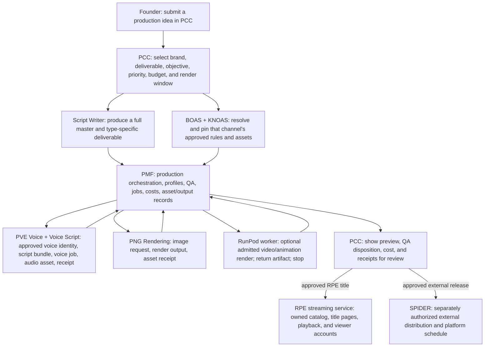

# PCC Animation Engine — system map v1

**Purpose:** produce channel-specific books, animation, reels, shorts, episodes, jingles, television commercials, and social campaigns from PCC, then deliver approved original RPE animation to RPE’s own streaming service and separately selected external platforms. PCC is the control surface. The founder starts a production request and reviews its result; the founder does not operate ComfyUI, configure model nodes, or manage GPU instances.

**Status:** architecture map for the first implementation pass. It describes the target behavior; it does not claim that remote rendering or live distribution is already wired.

## System map

## What each part owns

| Part | Responsibility | Must not do |
|---|---|---|
| PCC | Start the job, identify the brand/channel and deliverable, show queue/status/cost, collect review decisions | Send provider secrets to the browser or infer a channel from prompt text |
| Script Writer | Draft and revise the selected channel's content package; leave GPU work queued until it is ready | Change channel canon, authorize a render, or publish |
| BOAS / KNOAS | Supply the selected channel's binding creative, continuity, identity, and production constraints, pinned to approved revisions | Quietly fall back to another channel's rules or assets |
| PMF | Check authorization and lineage, compile a durable render manifest, queue/dispatch, reconcile artifacts and costs, run the trusted QA gate | Treat a render as approved/releasable just because it completed |
| RunPod worker | Provide temporary GPU capacity for the exact admitted manifest and return render artifacts/receipts | Hold channel credentials, choose creative policy, publish, or stay running while idle |
| RPE streaming service | Present RPE-owned titles through a branded catalog, series/episode pages, viewer accounts, entitlements, and playback; receive only PCC-approved, PMF-verified assets and metadata | Generate or rewrite content, approve its own production, or ingest unreleased assets automatically |
| SPIDER | Handle a separately authorized channel/platform connection and approved external publishing/scheduling action | Receive an unreviewed render as an automatic publish command |

## Normal job path

1. In PCC, start a **reel**, **short**, or **episode** and select its channel. The channel selection is explicit.
2. The Script Writer prepares the content package. PCC shows it as a draft/review item, not as a GPU job.
3. PCC/PMF resolve that channel's approved BOAS/KNOAS revisions and required assets. PMF blocks the job if a required binding is absent, expired, or belongs to another channel.
4. After the required content and production approvals, PMF freezes a hash-bound manifest and places it in the render queue. Writing can finish before any GPU is available.
5. At the configured evening/overnight window, the PMF dispatcher checks capacity and the per-job spending/runtime limits. It starts or provisions a compatible RunPod worker only when the job is admitted.
6. The worker runs the pinned workflow, reports progress and provider metering, uploads the output to the configured artifact store, and stops on completion, cancellation, timeout, or a hard-limit breach.
7. PMF verifies output lineage and QA evidence, then returns the preview, QA result, cost, and execution receipts to PCC.
8. PCC holds the render for human review. After explicit approval, PCC can route an RPE-owned title to the RPE streaming catalog, an external release to SPIDER, or both as separately selected destinations. Each destination has its own metadata, access, and schedule controls; neither release is implied by GPU completion.

## Job record and lifecycle

Each durable job binds: `job_id`, `channel_id`, deliverable type, source script/revision, BOAS and KNOAS revision IDs/hashes, authorized asset references, workflow/model profile, render-window policy, budget ceiling, idempotency key, execution ID, artifact hash/location, QA disposition, and receipts.

The target lifecycle is:

`DRAFT` → `CONTENT_REVIEW` → `POLICY_VALIDATION` → `READY_FOR_RENDER` → `WAITING_FOR_WINDOW` / `WAITING_FOR_CAPACITY` → `RENDERING` → `QA_REVIEW` → `FOUNDER_REVIEW` → `APPROVED_FOR_DISTRIBUTION` → `SCHEDULED` → `PUBLISHED`

Failures become visible blocked/failed states with a reason and receipt. Retries reuse the same admitted job identity and may not exceed its cost or retry limits. They must never create duplicate uploads.

## Access and cost boundary

- The RunPod API key stays in a server-side secret store. PCC's browser, Script Writer, ComfyUI workflow files, logs, and platform adapters never receive it.
- RunPod receives only the minimum job package needed to render. It receives no SPIDER tokens or general channel access.
- SPIDER platform tokens remain behind SPIDER's server-side boundary. The render approval does not grant publish approval.
- The dispatch window is a preference, not a promise that a GPU will be available. A stopped Pod releases its GPU; capacity can change before the next window.
- Each job has explicit maximum GPU rate, spend, wall time, and retry count. PMF reads the live provider meter and records actual cost. No GPU remains running after a job or while waiting for the next window.
- No paid render is dispatched until workflow/model compatibility, hard limits, server-side credentials, and the required institutional acceptance gates are verified.

## Current implementation boundary

The repository record identifies PMF PR #15 as a local-only sound-first episode runner and QA work, and PR #16 as a RunPod integration design. The local adapter is loopback-only; it is not a remote RunPod controller. The ComfyUI workflow shown in the supplied screenshot failed at **LTXV Empty Latent Audio**, so it is not a validated production workflow. The existing RunPod Pod was shown stopped. These facts mean the PCC-first architecture is defined, while PCC-to-PMF remote job submission, server-side RunPod dispatch, and a validated remote render have not yet been demonstrated.

The current SPIDER screenshots show two connected YouTube accounts (PHNX Kids and PHNX Kitchen) and six requiring reconnection. PHNX Faceless Reels and Gold Words exist as YouTube channels but were not shown in the SPIDER cards. Other platform accounts remain a separate inventory/authorization effort. This does not block drafting or preparing animation jobs; it blocks any platform action for an account whose mapping or authorization is not verified.

## Build order

1. Implement this job/state contract in PMF and expose PCC job creation, queue, status, review, and receipt views.
2. Add the server-side RunPod provider adapter behind PMF with mocked API tests first: capacity, start/provision, readiness, dispatch, cancellation, metering, artifact return, and guaranteed stop.
3. Bind the existing sound-first PMF compiler and QA path to a pinned, remotely usable ComfyUI workflow. Validate actual model/workflow compatibility before paid compute.
4. Wire PCC's channel context to the exact approved BOAS/KNOAS revisions and asset identities; fail closed on mismatches.
5. Prove one capped, owner-authorized render; return it to PCC for review and record the run receipt.
6. Add the RPE-owned streaming destination: approved-title ingest, catalog/series/episode metadata, playback, viewer access, captions, and resume progress. Keep monetization and native mobile/TV apps as later phases.
7. Add SPIDER distribution only after review, with a separate platform-target authorization and schedule receipt.

**Success condition:** the founder starts one job in PCC and receives a reviewable artifact and cost/QA receipt in PCC without opening RunPod or ComfyUI. Once approved, the title can be ingested into RPE’s own streaming catalog; external publishing remains a separate explicit decision.

## Output intelligence and marketing scope

PCC is the intake and routing decision point. The user supplies an idea, then PCC binds it to the selected brand/channel and requested deliverable. The shared Script Writer resolves that brand's approved BOAS/KNOAS, voice, audience, and campaign/series context; for narrative, it plans ending-first under EFPB and writes the complete master before segmentation. For commercial work, it uses the matching corporate jingle, television commercial, or social-campaign production profile. PMF checks the resulting package and runs the matching Reviewer/production QA contract.

Marketing quality gates are distinct from story-quality gates. They cover approved claims, offer/message, audience, brand voice/assets, legal copy, CTA, duration, accessibility, usage rights, and the selected platform's output constraints. Unsupported or unapproved facts are escalated to PCC; they are never improvised. A marketing request can produce one master concept plus surface-specific variants, with provenance back to its PCC request, channel/brand profile, BOAS/KNOAS revisions, and QA receipt.

The diagram describes the target system. The current PR adds intake types and documents these profiles; no writer, Reviewer, PMF dispatch, GPU render, or social publishing runtime is claimed as live.

## Existing voice, voice-script, and PNG rendering foundation

The connected Supabase project already contains these system subsystems. PCC/PMF should route through them as the existing production foundation rather than recreate them as one-off RunPod/ComfyUI nodes. The schema confirms the record shapes below; it does not by itself prove that PCC dispatch, provider calls, or artifact return are currently wired end to end.

| Existing subsystem | Existing tables | Animation Engine responsibility |
|---|---|---|
| PMF project and media-output control | `pm_projects`, `pm_content_jobs`, `pm_assets`, `pm_content_outputs` | Bind a job to its channel/content family; track ordered work; store preview/final/thumbnail asset references and metadata; return a PCC-reviewable output. |
| Voice selection and script preparation | `pm_voice_registry`, `pm_voice_assignments`, `pve_script_presets`, `pve_script_bundles`, `pve_script_bundle_items` | Resolve the assigned persona/voice for the chosen channel and output. Keep the full creative master in the Scriptwriter lineage; use PVE bundles/presets for the voice-production script/cues and reusable spoken segments. |
| PVE voice production and governance | `pve_personas`, `pve_voice_identities`, `pve_voice_authorizations`, `pve_provider_mappings`, `pve_voice_jobs`, `pve_voice_assets`, `pve_voice_receipts`, `pve_voice_asset_events`, `pve_voice_bank_status`, `pve_router_events`, `pve_provider_health`, `pve_tone_profiles`, `pve_surface_authorizations` | Check voice identity, consent/rights scope, channel/surface authorization, language/profile/provider routing and readiness; request narration, dialogue, or commercial audio; capture generated asset, status, hash, fallback, and receipt. |
| PNG Rendering | `png_requests`, `png_outputs` | Submit supported image/render requests and capture result/status for artwork, stills, or other PNG-backed assets. Bind each result to the PMF project/job before it enters a video render. Exact tool-key mapping and PCC dispatch must be verified before runtime use. |
| Optional video/animation compute | PMF render job → RunPod worker | Use rented GPU only for admitted video/animation work that the existing image/voice/PMF path cannot complete; it is an optional render worker, not the Animation Engine or a replacement for PVE/PNG. |

A marketing jingle or commercial can therefore use the relevant approved PVE voice and production profile; a social campaign can request channel-specific image assets through PNG where supported; animation can combine approved script, voice, images, and video rendering under one PMF job. Each subsystem returns versioned assets/receipts to PMF, and PCC presents the assembled preview for review. No subsystem may publish directly: SPIDER remains a separate, explicitly authorized distribution step.

## Verified runtime boundary (2026-10-28)

The live system is split across two Supabase projects. PCC authentication, command gateway, and workforce coordination live in **RPE Corporate HQ Canon** (`ttkceizmjeckrorhkhfr`). PMF/PVE/PNG data and the animation runtime live in the separate **RPE Systems project** (`oyjmpbuxvfxusmbouldi`). A table in the PMF project is not directly available to a PCC Edge Function: this requires an authenticated cross-project bridge with an explicit contract.

The PMF project already has `pcc_institutional.pmf_animation_runtime_v1(p_subject, p_action, p_packet)`, plus `pmf_animation_jobs` and `pmf_animation_artifacts`. Inspection confirms this is a constrained Angie’s World/CSE trial runtime, not a general channel renderer. It requires the active `PMF-BCR-ANGIE-TRIAL-001` build gate, a controlling PMF animation manifest, approved/right-cleared audio, pose and background assets physically present in the private bucket, and a maximum 600-frame timeline. Its production mode additionally checks one exact Angie’s World trial production/script. Completed artifacts are recorded as `ANIMATION_RECORDED_REVIEW_REQUIRED`; the runtime explicitly requires `quality_approved=false` and `distribution_performed=false`. This is a real working foundation, but it cannot accept arbitrary episode/ad/reel scripts as-is.

The voice, voice-script, and PNG tables are in that same separate PMF project: PMF project/output tables (`pm_projects`, `pm_content_jobs`, `pm_assets`, `pm_content_outputs`); approved voice assignments and script bundles/presets (`pm_voice_registry`, `pm_voice_assignments`, `pve_script_presets`, `pve_script_bundles`, `pve_script_bundle_items`); PVE voice authorization/job/asset/receipt tables; and PNG request/output tables (`png_requests`, `png_outputs`). They should remain the production foundation. Schema presence does not establish that a new PCC request can yet route through them.

The PCC intake draft now stores only the founder-owned request in the PCC project’s private `pcc_hq.animation_intake_requests` table. Its Edge Function validates the signed-in user and checks the existing Founder authorization RPC. It does not read PMF tables, dispatch to the PMF runtime, start RunPod, create voice/PNG jobs, or publish. Every submitted request stays held. The prior draft incorrectly placed the queue table in the PMF project while pointing its client at the PCC project; that mismatch is corrected in this branch.

**The remaining integration gate is the authenticated PCC-to-PMF project bridge**: it must preserve Founder authority, map request/channel/canon and BOAS/KNOAS revisions into the PMF Script Writer and Reviewer contracts, call only existing authorized PMF/PVE/PNG operations, and return immutable output/artifact receipts to PCC. The Angie’s World trial runtime remains gated until PMF expands and certifies a general production contract. RunPod can be added only after that contract accepts a reviewed job and provides an explicit spend/stop limit. Do not deploy the old cross-project assumption or report this engine as end-to-end operational.

## PCC production-lane routing

“Corporate” in this system means RPE corporate marketing. PCC routes a request using the requested deliverable plus its selected brand/channel and objective:

| PCC request type | Production lane | Primary QA |
|---|---|---|
| Corporate jingle, TV commercial, social campaign | RPE corporate marketing | Approved-claims, offer/CTA, legal copy, brand/usage rights, duration, accessibility and surface requirements |
| Book manuscript, story animation, micro-drama, series episode | Channel narrative | EFPB ending/payoff, cause-and-effect, character/canon continuity and audience/format fit |
| Ad or reel | Explicit PCC intent, informed by selected brand/channel and objective | Marketing QA for promotional work; narrative QA for story work |

PCC must keep a promotional reel/ad on the corporate marketing path and story-based animation/reels on the narrative path. If intent is ambiguous, it stays in PCC for clarification rather than running both profiles by default. The shared Script Writer can serve both lanes, but each request gets the matching BOAS/KNOAS profile and Reviewer rubric.

## PMF Voice, PVE Voice/Script, and CEP execution mapping

These are existing production components in the Systems Supabase project. PCC supplies a request and its provenance; it does not duplicate these records in the PCC database.

| Component | Existing records and interface | Animation Engine use |
|---|---|---|
| PMF voice selection | `pm_voice_registry`, `pm_voice_assignments`, `get_voice_for_job(p_project, p_channel, p_content_type, p_persona)` | Resolve a voice only for the selected PMF project, channel, content type, and persona. Preserve the selected voice ID and assignment context on the production job. |
| PVE voice and voice script | `pve_script_presets`, `pve_script_bundles`, `pve_script_bundle_items`; PVE identity, authorization, job, asset, and receipt tables | Use approved presets/bundles for voice-ready lines and cues. Check identity, consent/authorization, provider/profile and surface scope before creating voice work. Return audio assets and PVE receipts to the PMF job lineage. |
| CEP asynchronous execution | `cep_v2_jobs`, `cep_v2_artifacts`; `cep_v2_enqueue_job`, `cep_v2_claim_next_job`, `cep_v2_complete_job`, `cep_v2_fail_job` | Carry an admitted Animation Engine work item through the existing CEP V2 queue and record its resulting artifact/terminal state. CEP is transport and job lifecycle; the animation-specific worker performs the task, while PMF remains authoritative for project, assets, QA and output lineage. |
| PCC handoff | Authenticated PCC request ID, selected channel and production intent, approved BOAS/KNOAS revisions, complete master/segments, Reviewer receipt | Send a bound, idempotent request to the Systems-side adapter; reconcile its CEP/PMF/PVE receipts back to the same PCC request for review. |

### Execution gate

The CEP V2 queue is physically present; the live readback showed `risk_readiness` jobs, and its legacy one-argument claim is global across domains. An additive three-argument scoped claim (`locked_by`, `cep_id`, `domain`) and rollback-based isolation test are now in Systems PR #13. They are source changes only: not yet applied to the Systems database, and they do not by themselves create an Animation Engine consumer. The next implementation must bind the consumer to the approved job's exact `cep_id` and `domain`, use the existing completion/failure receipts, and authenticate the cross-project PCC-to-Systems call. The known-drift `api.execute_cep_v2_once` wrapper remains out of the path. Until this bridge and worker are verified, requests stay held; no voice provider, render worker, GPU spend, or publishing starts.

## RPE-owned animation streaming service

The screenshot identifies a separate product destination for the Animation Engine: an RPE-owned streaming service for the company’s original animation and series. This is distinct from both the production engine and SPIDER. PCC and PMF create, validate, and package titles; the streaming service manages the viewer experience and RPE’s owned catalog. SPIDER continues to distribute to external platforms.

### First release

- A branded web service with a browse/home page, featured collections, search, and title detail pages.
- A catalog hierarchy for franchise, series, season, episode, shorts, films, and trailers, with descriptions, artwork, age guidance, release state, captions, audio-language options, and credits.
- A secure video player with adaptive delivery, captions, playback resume, and watch progress.
- Viewer accounts and an explicit access rule for each title. The initial access model remains to be selected; subscriptions, advertising, and payments are later product decisions.
- A controlled catalog-ingest action that accepts only a PCC-approved release package and PMF-verified video/artwork/caption assets. Store each asset’s source job, hash, rights/provenance, and version.

### Release path

PCC approval → PMF release package → streaming catalog ingest → video delivery/encoding → viewer playback

The platform may use managed storage, encoding, and CDN capacity behind the RPE-owned brand and application. “Our own version” means RPE owns the catalog, product experience, release rules, and viewer relationship; it does not require rebuilding codecs or a global CDN. Keep the delivery provider replaceable.

### Product boundary

The Animation Engine is the manufacturing pipeline. The RPE streaming service is the owned viewing destination. A finished animation is not visible to viewers until PCC approves the release, PMF verifies its package, and the catalog item is deliberately published. This service does not ingest third-party shows or copy Crunchyroll branding, artwork, or catalog content. Monetization, privacy/access policies, content rights, and child-directed features are separate acceptance gates before public launch.