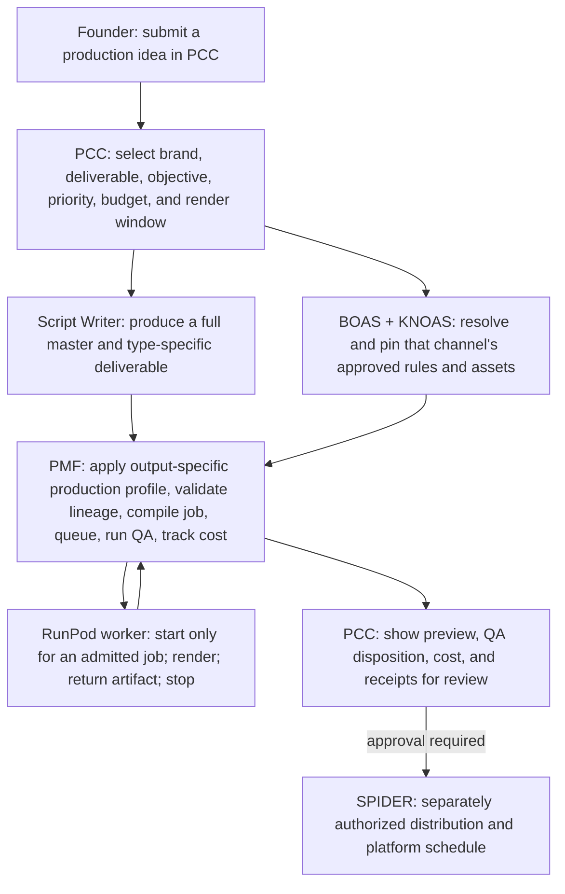

# PCC Animation Engine — system map v1

**Purpose:** produce channel-specific books, animation, reels, shorts, episodes, jingles, television commercials, and social campaigns from PCC. PCC is the control surface. The founder starts a production request and reviews its result; the founder does not operate ComfyUI, configure model nodes, or manage GPU instances.

**Status:** architecture map for the first implementation pass. It describes the target behavior; it does not claim that remote rendering or live distribution is already wired.

## System map

## What each part owns

| Part | Responsibility | Must not do |
|---|---|---|
| PCC | Start the job, identify the brand/channel and deliverable, show queue/status/cost, collect review decisions | Send provider secrets to the browser or infer a channel from prompt text |
| Script Writer | Draft and revise the selected channel's content package; leave GPU work queued until it is ready | Change channel canon, authorize a render, or publish |
| BOAS / KNOAS | Supply the selected channel's binding creative, continuity, identity, and production constraints, pinned to approved revisions | Quietly fall back to another channel's rules or assets |
| PMF | Check authorization and lineage, compile a durable render manifest, queue/dispatch, reconcile artifacts and costs, run the trusted QA gate | Treat a render as approved/releasable just because it completed |
| RunPod worker | Provide temporary GPU capacity for the exact admitted manifest and return render artifacts/receipts | Hold channel credentials, choose creative policy, publish, or stay running while idle |
| SPIDER | Handle a separately authorized channel/platform connection and, later, the approved publishing/scheduling action | Receive an unreviewed render as an automatic publish command |

## Normal job path

1. In PCC, start a **reel**, **short**, or **episode** and select its channel. The channel selection is explicit.
2. The Script Writer prepares the content package. PCC shows it as a draft/review item, not as a GPU job.
3. PCC/PMF resolve that channel's approved BOAS/KNOAS revisions and required assets. PMF blocks the job if a required binding is absent, expired, or belongs to another channel.
4. After the required content and production approvals, PMF freezes a hash-bound manifest and places it in the render queue. Writing can finish before any GPU is available.
5. At the configured evening/overnight window, the PMF dispatcher checks capacity and the per-job spending/runtime limits. It starts or provisions a compatible RunPod worker only when the job is admitted.
6. The worker runs the pinned workflow, reports progress and provider metering, uploads the output to the configured artifact store, and stops on completion, cancellation, timeout, or a hard-limit breach.
7. PMF verifies output lineage and QA evidence, then returns the preview, QA result, cost, and execution receipts to PCC.
8. PCC holds the render for human review. Only an explicit release decision can advance it to a platform-specific SPIDER action. Platform authorization and scheduling are separate from GPU authorization.

## Job record and lifecycle

Each durable job binds: `job_id`, `channel_id`, deliverable type, source script/revision, BOAS and KNOAS revision IDs/hashes, authorized asset references, workflow/model profile, render-window policy, budget ceiling, idempotency key, execution ID, artifact hash/location, QA disposition, and receipts.

The target lifecycle is:

`DRAFT` → `CONTENT_REVIEW` → `POLICY_VALIDATION` → `READY_FOR_RENDER` → `WAITING_FOR_WINDOW` / `WAITING_FOR_CAPACITY` → `RENDERING` → `QA_REVIEW` → `FOUNDER_REVIEW` → `APPROVED_FOR_DISTRIBUTION` → `SCHEDULED` → `PUBLISHED`

Failures become visible blocked/failed states with a reason and receipt. Retries reuse the same admitted job identity and may not exceed its cost or retry limits. They must never create duplicate uploads.

## Access and cost boundary

- The RunPod API key stays in a server-side secret store. PCC's browser, Script Writer, ComfyUI workflow files, logs, and platform adapters never receive it.
- RunPod receives only the minimum job package needed to render. It receives no SPIDER tokens or general channel access.
- SPIDER platform tokens remain behind SPIDER's server-side boundary. The render approval does not grant publish approval.
- The dispatch window is a preference, not a promise that a GPU will be available. A stopped Pod releases its GPU; capacity can change before the next window.
- Each job has explicit maximum GPU rate, spend, wall time, and retry count. PMF reads the live provider meter and records actual cost. No GPU remains running after a job or while waiting for the next window.
- No paid render is dispatched until workflow/model compatibility, hard limits, server-side credentials, and the required institutional acceptance gates are verified.

## Current implementation boundary

The repository record identifies PMF PR #15 as a local-only sound-first episode runner and QA work, and PR #16 as a RunPod integration design. The local adapter is loopback-only; it is not a remote RunPod controller. The ComfyUI workflow shown in the supplied screenshot failed at **LTXV Empty Latent Audio**, so it is not a validated production workflow. The existing RunPod Pod was shown stopped. These facts mean the PCC-first architecture is defined, while PCC-to-PMF remote job submission, server-side RunPod dispatch, and a validated remote render have not yet been demonstrated.

The current SPIDER screenshots show two connected YouTube accounts (PHNX Kids and PHNX Kitchen) and six requiring reconnection. PHNX Faceless Reels and Gold Words exist as YouTube channels but were not shown in the SPIDER cards. Other platform accounts remain a separate inventory/authorization effort. This does not block drafting or preparing animation jobs; it blocks any platform action for an account whose mapping or authorization is not verified.

## Build order

1. Implement this job/state contract in PMF and expose PCC job creation, queue, status, review, and receipt views.
2. Add the server-side RunPod provider adapter behind PMF with mocked API tests first: capacity, start/provision, readiness, dispatch, cancellation, metering, artifact return, and guaranteed stop.
3. Bind the existing sound-first PMF compiler and QA path to a pinned, remotely usable ComfyUI workflow. Validate actual model/workflow compatibility before paid compute.
4. Wire PCC's channel context to the exact approved BOAS/KNOAS revisions and asset identities; fail closed on mismatches.
5. Prove one capped, owner-authorized render; return it to PCC for review and record the run receipt.
6. Add SPIDER distribution only after review, with a separate platform-target authorization and schedule receipt.

**Success condition:** the founder starts one job in PCC and receives a reviewable artifact and cost/QA receipt in PCC without opening RunPod or ComfyUI. Publishing remains an explicit later decision.

## Output intelligence and marketing scope

PCC is the intake and routing decision point. The user supplies an idea, then PCC binds it to the selected brand/channel and requested deliverable. The shared Script Writer resolves that brand's approved BOAS/KNOAS, voice, audience, and campaign/series context; for narrative, it plans ending-first under EFPB and writes the complete master before segmentation. For commercial work, it uses the matching corporate jingle, television commercial, or social-campaign production profile. PMF checks the resulting package and runs the matching Reviewer/production QA contract.

Marketing quality gates are distinct from story-quality gates. They cover approved claims, offer/message, audience, brand voice/assets, legal copy, CTA, duration, accessibility, usage rights, and the selected platform's output constraints. Unsupported or unapproved facts are escalated to PCC; they are never improvised. A marketing request can produce one master concept plus surface-specific variants, with provenance back to its PCC request, channel/brand profile, BOAS/KNOAS revisions, and QA receipt.

The diagram describes the target system. The current PR adds intake types and documents these profiles; no writer, Reviewer, PMF dispatch, GPU render, or social publishing runtime is claimed as live.
